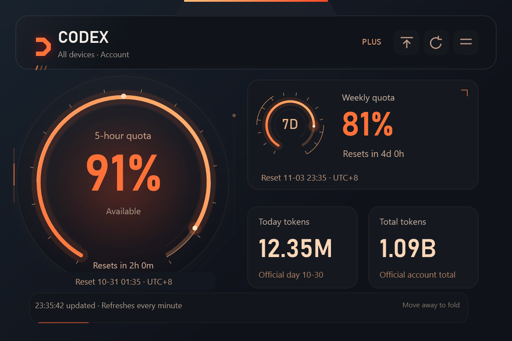

# Codex Quota Widget · Codex 用量悬浮窗

**面向 ChatGPT Plus 用户深度定制的 Windows Codex 用量悬浮工具。**

**A Windows Codex usage widget deeply tailored to ChatGPT Plus users.**

把 5 小时和周剩余额度、恢复时间，以及今日和累计 token 放到桌面顶部，方便安排 Codex 工作节奏。

Keep your remaining 5-hour and weekly quotas, reset times, and daily and lifetime token usage at the top of your desktop.

作者 / Author: **suqi456** · 桌面程序 / Desktop: **1.4.7** · 插件 / Plugin: **1.1.6**

[中文](#中文) · [English](#english) · [下载 / Download](https://github.com/pax-et-bonum-03/codex-quota-widget/releases/latest)

## 界面展示 · Interface previews

### 中文界面


### English interface




截图使用演示数据。本项目独立开发，与 OpenAI 无隶属关系。

Screenshots use demo data. This is an independently developed project, unaffiliated with OpenAI.

## 中文

### 功能

- 围绕 ChatGPT Plus 用户的 Codex 使用需求深度定制。
- 收起查看 5h 和周剩余百分比及恢复时间，悬停展开今日与累计 token。
- 橙红机甲界面，跨应用置顶，支持拖动、位置记忆和一键复原。
- 内置简体中文、繁體中文与 English，支持自定义 JSON 语言包。
- 可选随 Windows 登录启动，首次安装默认关闭。
- 独立后台读取当前 Codex 账户用量，不修改主程序的登录、配置和会话文件。

### 安装与操作

需要 **Windows 10/11 x64**、[.NET 8 Desktop Runtime](https://dotnet.microsoft.com/download/dotnet/8.0)，以及已登录 ChatGPT Plus 账户的 Codex 桌面应用。运行时下载页选择 **Desktop Runtime**；本包不附带运行时，Windows ARM64 尚未验证。

1. 从 [Releases](https://github.com/pax-et-bonum-03/codex-quota-widget/releases/latest) 下载 `CodexQuotaWidget-1.4.7-windows-x64.zip`，解压后双击 `Start.cmd`。
2. 程序安装到 `%LOCALAPPDATA%/CodexQuotaWidget/app`。以后运行 `Start.cmd` 可启动或检查安装。
3. 右键悬浮窗或托盘图标，可切换语言、设置开机启动、复原位置或退出。

```powershell
powershell -NoProfile -ExecutionPolicy Bypass -File .\widget.ps1 -Action start
powershell -NoProfile -ExecutionPolicy Bypass -File .\widget.ps1 -Action status
powershell -NoProfile -ExecutionPolicy Bypass -File .\widget.ps1 -Action stop
powershell -NoProfile -ExecutionPolicy Bypass -File .\widget.ps1 -Action uninstall
```

`Bypass` 仅作用于本次进程，不修改系统执行策略。卸载保留 `data` 中的偏好、位置和语言包。程序与脚本尚未数字签名；Release 提供 SHA-256 校验文件。

### 在 Codex 中安装插件

```powershell
codex plugin marketplace add pax-et-bonum-03/codex-quota-widget
codex plugin add codex-quota-widget@codex-quota-widget-releases
```

也可在解压的源码目录运行 `codex plugin marketplace add .`。安装后可说“启动 Codex 用量悬浮窗”“关闭悬浮窗”或“检查悬浮窗状态”。插件开关控制技能调用；桌面进程独立运行。

### 统计口径

剩余百分比为 `100 - usedPercent`；按接口返回的时长识别 5h 和周窗口。token 来自 Codex 账户级历史统计，包含服务端记录的其他设备 Codex 用量，不代表普通 ChatGPT 网页聊天的全部 token。

“今日”按北京时间日期匹配官方日桶，日界时区未公开，统计可能延迟；缺失时显示“尚未更新”。界面时间固定为 **UTC+8**。每分钟刷新，读取失败时保留上次读数并提示错误。可用字段取决于 Codex 版本和账户实际返回的数据。

### 安全加固

1.4.7 在传递凭据前验证 Codex 的 Windows 签名与 OpenAI 发布者，优先使用官方安装目录；拒绝未签名、被篡改、其他发布者、网络位置和链接路径中的程序。验证失败时停止连接。下载包由 GitHub 从源码构建、测试，并提供可核验的构建来源证明。程序仍未进行 Windows 发布者签名，详情见 [安全说明](SECURITY.md)。

### 双语文档

- [完整使用说明](docs/使用说明.md)
- [隐私说明](PRIVACY.md)
- [语言包格式](docs/语言包格式说明.md)
- [更新记录](CHANGELOG.md)
- [Release 说明](docs/RELEASE_NOTES.md)
- [发布与打包指南](PUBLISHING.md)
- [测试入口](tests/README.md)
- [发布核查记录](docs/RELEASE_CHECKS.md)
- [第三方组件与授权](THIRD_PARTY_NOTICES.md)
- [MIT 许可证中文参考译文](LICENSE.zh-CN.md)

上述说明均提供中文和英文内容，使用独立段落、左对齐排版。英文原始许可证保留原文。

### 源码构建与授权

在 Windows 安装 .NET 8 SDK，在仓库根目录运行：

```powershell
powershell -NoProfile -ExecutionPolicy Bypass -File .\scripts\build.ps1
```

源码位于 `src/CodexQuotaWidget`。构建更新插件程序与校验清单。代码采用 [MIT License](LICENSE)，字体采用 SIL Open Font License 1.1。

---

## English

### Features

- Deeply tailored to ChatGPT Plus users' everyday Codex workflows.
- See remaining 5-hour and weekly quotas and reset times in the collapsed bar; hover for daily and lifetime token usage.
- An orange-red mecha interface that stays above other apps, with dragging, saved position, and one-click reset.
- Built-in Simplified Chinese, Traditional Chinese, and English, plus custom JSON language packs.
- Optional startup at Windows sign-in, disabled by default on first installation.
- A separate backend reads current Codex account usage without modifying the desktop app's login, configuration, or session files.

### Installation and controls

Requires **Windows 10/11 x64**, the [.NET 8 Desktop Runtime](https://dotnet.microsoft.com/download/dotnet/8.0), and the Codex desktop app signed in with your ChatGPT Plus account. Choose **Desktop Runtime** on the runtime download page. It is not bundled; Windows ARM64 has not been verified.

1. Download `CodexQuotaWidget-1.4.7-windows-x64.zip` from [Releases](https://github.com/pax-et-bonum-03/codex-quota-widget/releases/latest), extract it, and double-click `Start.cmd`.
2. The app installs to `%LOCALAPPDATA%/CodexQuotaWidget/app`. Run `Start.cmd` again to launch it or check the installation.
3. Right-click the widget or tray icon to change language, configure startup, reset position, or quit.

```powershell
powershell -NoProfile -ExecutionPolicy Bypass -File .\widget.ps1 -Action start
powershell -NoProfile -ExecutionPolicy Bypass -File .\widget.ps1 -Action status
powershell -NoProfile -ExecutionPolicy Bypass -File .\widget.ps1 -Action stop
powershell -NoProfile -ExecutionPolicy Bypass -File .\widget.ps1 -Action uninstall
```

`Bypass` applies only to that process and does not change the system execution policy. Uninstalling preserves preferences, position, and language packs under `data`. The app and scripts are unsigned; SHA-256 checksums accompany the release.

### Install the Codex plugin

```powershell
codex plugin marketplace add pax-et-bonum-03/codex-quota-widget
codex plugin add codex-quota-widget@codex-quota-widget-releases
```

Alternatively, run `codex plugin marketplace add .` from the extracted source directory. After installation, ask Codex to “start the Codex quota widget,” “stop the widget,” or “check the widget status.” The plugin toggle controls skill access; the desktop process runs independently.

### Statistical definitions

Remaining quota is `100 - usedPercent`. Window durations returned by Codex identify the 5-hour and weekly limits. Token counts come from Codex account-level history, including usage recorded for other devices. They do not represent all token usage in ordinary ChatGPT web chats.

“Today” matches the Beijing-date label to the official daily bucket. The bucket's day-boundary time zone is undocumented, and reporting may be delayed. Missing data is shown as “Not updated yet.” Displayed times use **UTC+8**. The widget refreshes once per minute and retains previous readings with an error when reading fails. Available fields depend on the Codex version and the data returned for the account.

### Security hardening

Desktop 1.4.7 verifies Codex’s Windows signature and OpenAI publisher before passing credentials, preferring the official installation directory. Unsigned, modified, other-publisher, network, and linked executable paths are rejected. Failed verification stops the connection. GitHub builds and tests the packages from source and provides verifiable build provenance. The widget itself remains unsigned for Windows; see [Security](SECURITY.md).

### Bilingual documentation

- [Complete user guide](docs/使用说明.md)
- [Privacy notice](PRIVACY.md)
- [Language-pack format](docs/语言包格式说明.md)
- [Changelog](CHANGELOG.md)
- [Release notes](docs/RELEASE_NOTES.md)
- [Publishing and packaging guide](PUBLISHING.md)
- [Test guide](tests/README.md)
- [Release validation record](docs/RELEASE_CHECKS.md)
- [Third-party notices](THIRD_PARTY_NOTICES.md)
- [Chinese reference translation of the MIT License](LICENSE.zh-CN.md)

These guides provide Chinese and English content in separate, left-aligned paragraphs. Original English license texts are preserved.

### Build and license

Install the .NET 8 SDK on Windows, then run from the repository root:

```powershell
powershell -NoProfile -ExecutionPolicy Bypass -File .\scripts\build.ps1
```

Source code is in `src/CodexQuotaWidget`. Building updates the plugin program files and checksum manifest. Code is licensed under the [MIT License](LICENSE); bundled fonts use SIL Open Font License 1.1.
