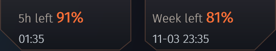
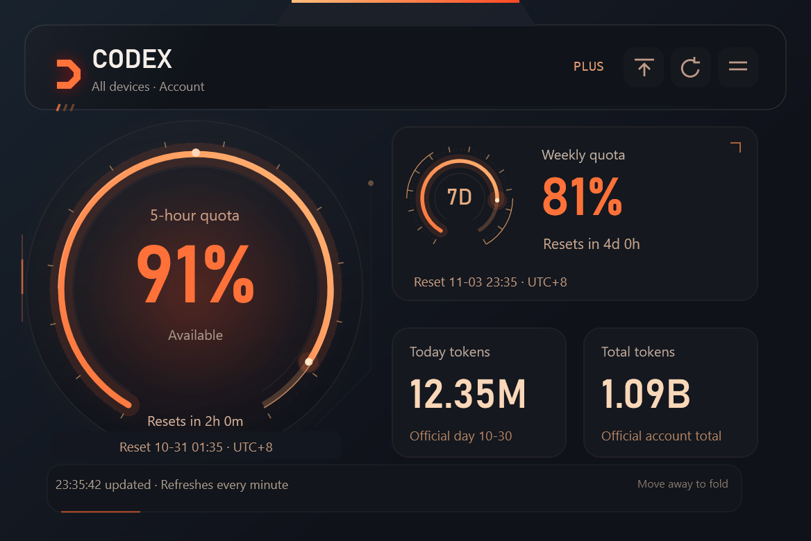

# Codex Quota Widget 1.4.7 / Plugin 1.1.6

**面向 ChatGPT Plus 用户深度定制的 Windows Codex 用量悬浮工具。**

**A Windows Codex usage widget deeply tailored to ChatGPT Plus users.**

## 中文

### 发布更新

使用独立的公开提交历史与 GitHub 匿名提交邮箱，更新全部仓库链接。源码、安装包和插件包均从本仓库重新构建并提供签名来源证明。保留桌面程序 1.4.7 的安全加固与中英双语展示。

### 安全加固

在读取或传递账户凭据前，先验证 Codex 的 Windows Authenticode 签名与 OpenAI 发布者。优先官方安装目录，拒绝未签名、被篡改、发布者不符、网络位置及链接路径中的程序。验证后锁定文件，阻止后台存续期间写入或替换；失败时停止连接，不向该程序传递凭据。

GitHub 从源码构建并运行安全检查后打包；Actions 固定完整提交 SHA，checkout 不保存凭据。新版下载包提供 SHA-256 与签名构建来源证明。悬浮窗本身仍未进行 Windows 发布者代码签名，来源证明不替代 Authenticode。

原有 31 项账户隔离检查通过；本机原生信任检查通过 13 项，包含真实 OpenAI 签名、文件锁、错误发布者和篡改副本。受系统权限限制，本机符号链接创建检查被明确跳过。CI 未提供真实 Codex 时，会明确跳过正向签名检查，不会连接真实账户。

### 安装

下载 `CodexQuotaWidget-1.4.7-windows-x64.zip`，解压后运行 `Start.cmd`。需要 Windows 10/11 x64、.NET 8 Desktop Runtime，以及从官方来源安装并已登录的 Codex。保留 5h/周额度、恢复时间、今日/累计 token、拖动复原、三种语言与可选开机启动。程序用量不代表普通 ChatGPT 网页聊天的全部 token。

## English

### Publication update

This release uses independent public history and GitHub noreply commit addresses, with updated repository links. Source, Windows, and plugin archives are rebuilt in this repository with signed provenance. Desktop 1.4.7 security hardening and bilingual screenshots are retained.

### Security hardening

Before reading or passing account credentials, verify the Codex Windows Authenticode signature and OpenAI publisher. Prefer the official installation and reject unsigned, modified, wrong-publisher, network, and linked executables. Lock the verified file against writing or replacement for the backend lifetime. Failed verification stops the connection without passing credentials to that program.

GitHub builds from source and runs security checks before packaging. Actions are pinned to full commit SHAs, and checkout does not retain credentials. New archives include SHA-256 checksums and signed build provenance. The widget itself remains unsigned for Windows; provenance does not replace Authenticode.

All 31 account-isolation checks passed. Thirteen local native trust checks passed, covering a real OpenAI signature, file locks, a wrong publisher, and a tampered copy. Creating a symbolic-link fixture was explicitly skipped because of local permissions. CI without a real Codex executable explicitly skips positive-signature checks and never connects to a real account.

### Installation

Download `CodexQuotaWidget-1.4.7-windows-x64.zip`, extract it, and run `Start.cmd`. Requires Windows 10/11 x64, .NET 8 Desktop Runtime, and Codex installed from its official source and signed in. Retains 5-hour/weekly quotas, reset times, daily/lifetime tokens, dragging and position reset, three languages, and optional startup. Usage is not the total for ordinary ChatGPT web chats.

## 下载 · Downloads

| 文件 · File | 用途 · Purpose |
| --- | --- |
| `CodexQuotaWidget-1.4.7-windows-x64.zip` | Windows 安装包 · Windows installer package |
| `codex-quota-widget-1.1.6-plugin.zip` | Codex 插件 · Codex plugin |
| `codex-quota-widget-1.1.6-source.zip` | 源码与双语说明 · Source and bilingual guides |
| `SHA256SUMS.txt` | 完整性校验 · Integrity checksums |
| `build-provenance.sigstore.json` | 签名构建来源证明 · Signed build provenance |

## 中文界面 · Chinese interface

## English interface · 英文界面

作者 · Author: **suqi456**. [安全说明 · Security](https://github.com/pax-et-bonum-03/codex-quota-widget/blob/main/SECURITY.md)
